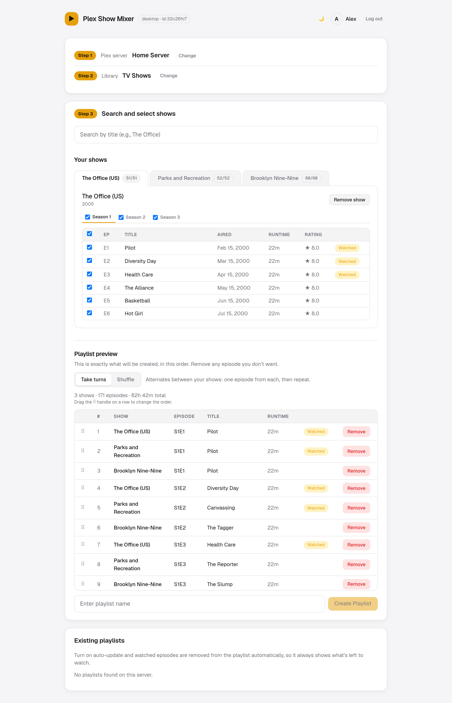
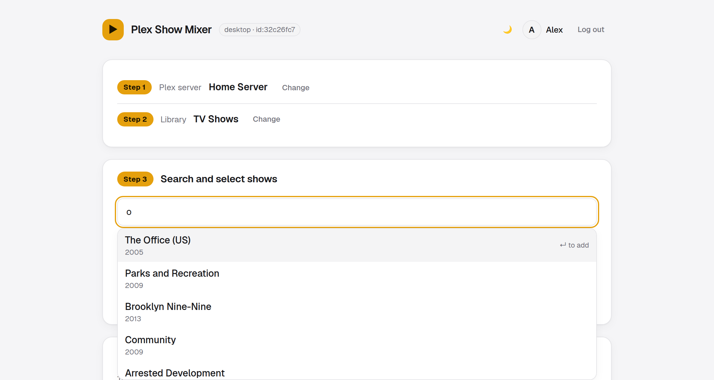
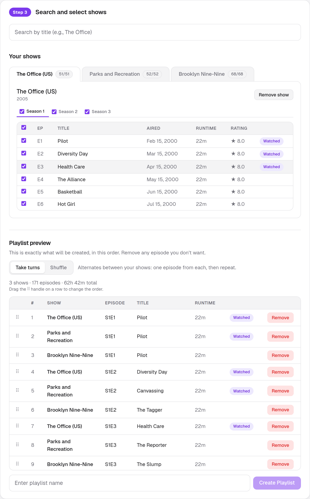
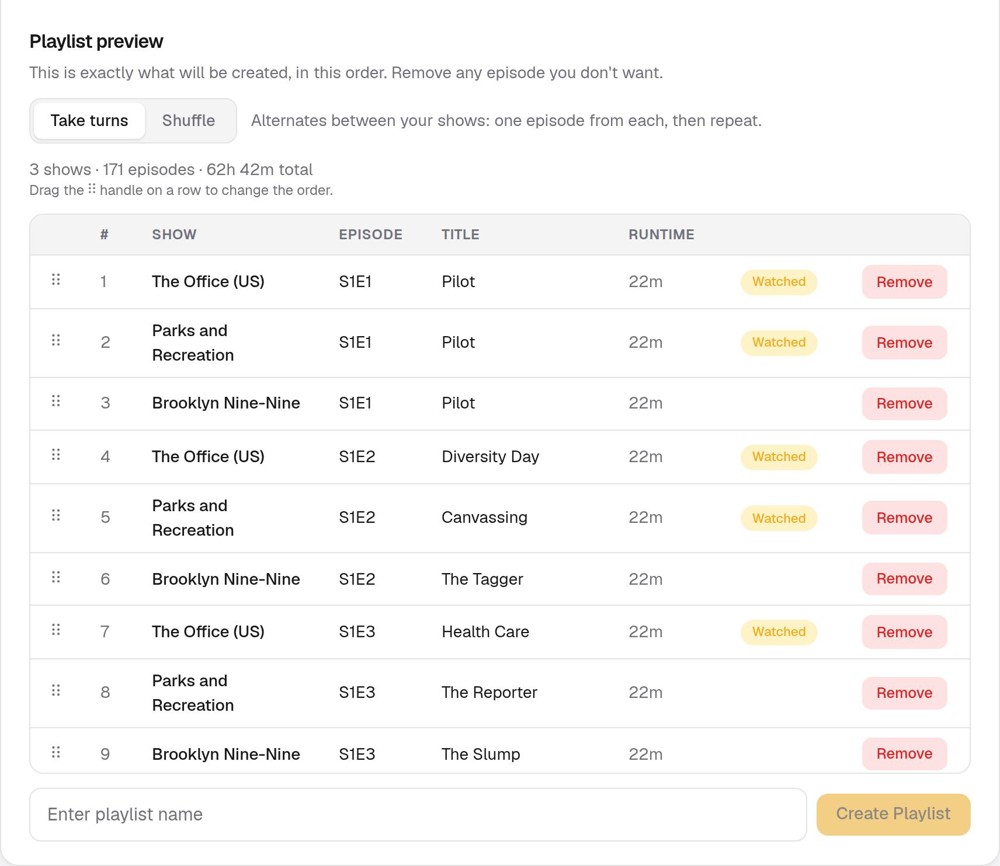
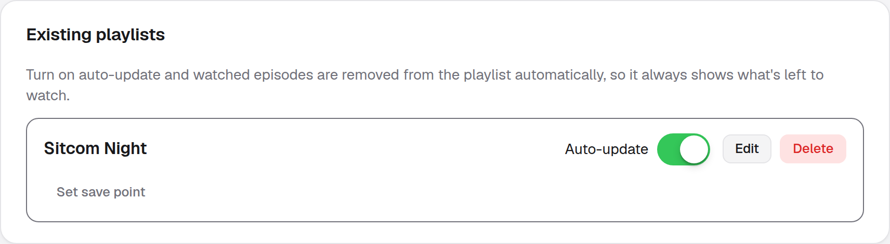

<div align="center">


# Bingemix <sub>for Plex</sub>

**Multiple shows. One playlist.**

Interleave or shuffle your favourite shows into one auto-updating playlist.
Take turns between shows, one episode each, or shuffle them. Watched episodes
drop out on their own.

[](https://hub.docker.com/r/gurjaps/bingemix)
[](https://hub.docker.com/r/gurjaps/bingemix)

<a href="docs/screenshots/dashboard.png">
  <picture>
    <source media="(prefers-color-scheme: dark)" srcset="docs/screenshots/dashboard-dark.png">
    
  </picture>
</a>

</div>

## Features

- **Search and pick**: search your Plex TV library, then choose shows, seasons and individual episodes
- **Take turns or shuffle**: alternate between shows, or shuffle everything, then drag rows to fine-tune the order
- **Preview first**: see exactly what will be created (runtime, air dates, ratings, watched status) before it touches Plex
- **Auto-update**: episodes are removed from a playlist once you have watched them
- **Save points**: reset a playlist to an earlier state
- **Multi-user**: several people (and Plex Home profiles) can share one install; each has their own playlists and auto-update
- **Private**: you sign in with Plex (plex.tv/link), and your Plex password is never seen or stored

## Screenshots

<table>
  <tr>
    <td width="50%">
      <a href="docs/screenshots/search.png"></a>
      <p align="center"><b>Search your library</b><br>Press Enter to add a show</p>
    </td>
    <td width="50%">
      <a href="docs/screenshots/shows.png"></a>
      <p align="center"><b>Choose seasons and episodes</b><br>Watched episodes are flagged</p>
    </td>
  </tr>
  <tr>
    <td width="50%">
      <a href="docs/screenshots/preview.png"></a>
      <p align="center"><b>Preview the mix</b><br>Take turns or shuffle, drag to reorder</p>
    </td>
    <td width="50%">
      <a href="docs/screenshots/playlists.png"></a>
      <p align="center"><b>Manage playlists</b><br>Auto-update, save points, edit, delete</p>
    </td>
  </tr>
</table>

Light and dark themes are built in.

<sub>Screenshots use a fake Plex server with sample shows, so no real library is shown.</sub>

## How it works

1. **Sign in** with Plex using the plex.tv/link code flow.
2. **Pick** a server and a TV library, then search and add shows.
3. **Preview and create**: choose take turns or shuffle, tweak the order, name the playlist.
4. **Turn on auto-update** and watched episodes drop out of the playlist on their own.

## Run with Docker

```bash
docker run -d --name bingemix \
  -p 6767:6767 \
  -v ./data:/app/data \
  -v ./secrets:/app/secrets \
  --restart unless-stopped \
  gurjaps/bingemix:latest
```

Then open <http://localhost:6767>. The `data/` and `secrets/` folders are
created next to where you ran the command.

- `data/` holds the app's state.
- `secrets/` holds the key that encrypts stored Plex tokens (see
  [Token encryption](#token-encryption)). It is kept apart from `data/` on
  purpose: back both up, but store them separately.

### Docker Compose

Save this as `docker-compose.yml` anywhere; it just pulls the published image:

```yaml
services:
  bingemix:
    image: gurjaps/bingemix:latest
    container_name: bingemix
    ports:
      - "6767:6767"
    volumes:
      - ./data:/app/data
      - ./secrets:/app/secrets
    restart: unless-stopped
```

```bash
docker compose up -d
```

> The `docker-compose.yml` in this repository is different: it **builds the
> image from the source** in this checkout (and reads `PORT` and
> `TOKEN_ENCRYPTION_KEY` from a `.env` file). Use it if you cloned the repo to
> hack on it; otherwise use the version above.

## Configuration

All settings are optional environment variables.

| Variable | Purpose |
| --- | --- |
| `PORT` | Port to listen on (default `6767`). |
| `TOKEN_ENCRYPTION_KEY` | Optional. 32-byte base64 key used to encrypt Plex tokens. See below. |
| `TOKEN_ENCRYPTION_KEY_FILE` | Optional. Path to a file (e.g. a Docker secret) containing the key instead. |
| `PLEX_CLIENT_ID` | Fixed identifier Plex uses for this install. Generated and saved to `data/client_id` if unset. |
| `INSTANCE_NAME` | Name shown when another copy of the app sees this one auto-updating a playlist. Defaults to the machine name. |
| `DATA_DIR` | Parent folder for the `data/` and `secrets/` directories. |
| `AUTO_UPDATE_POLL_INTERVAL_MS` | How often auto-update checks playlists (default 5 minutes). |

### Token encryption

Auto-update needs to keep your Plex access token so it can work while you are
away. Tokens are stored encrypted (AES-256-GCM), and **no setup is needed**: on
first run the app generates a key and saves it at `secrets/encryption_key`,
separate from the encrypted tokens in `data/`. A copy of the `data/` folder (a
backup, a shared drive) is therefore useless without the key.

Optionally, bring your own key instead. It is looked up in this order:

1. `TOKEN_ENCRYPTION_KEY` (optional)
2. `TOKEN_ENCRYPTION_KEY_FILE` (optional, e.g. a Docker secret)
3. `secrets/encryption_key` (generated on first run)
4. `data/.encryption_key` (where earlier versions kept it; still used if present)

Generate a key with `openssl rand -base64 32`. If the key is lost or changed,
stored tokens cannot be read and people just sign in again.

> Running without a `secrets` volume still works, but the generated key is then
> lost whenever the container is recreated, and everyone has to sign in again.
> Mount `./secrets:/app/secrets` as shown above.

## Good to know

- Playlists are built from **one Plex server at a time**. A Plex playlist lives
  on a single server and can only contain that server's items.
- If you run more than one copy of the app against the same Plex server, the
  app leaves a short note in the playlist description in Plex
  (`Auto-updated by Bingemix (...)`) so other copies can warn you that a
  playlist is already being updated elsewhere. Copies from before the rename
  wrote `Auto-updated by Plex Show Mixer (...)`; Bingemix still understands
  those, but older releases do not understand the new wording, so upgrade every
  copy that points at the same server together.

## Renamed from Plex Show Mixer

Bingemix was called Plex Show Mixer until version 1.2.3. The Docker image is now
`gurjaps/bingemix`. To move over, stop the old container and start the new one
with the **same** `data/` folder (and `secrets/` if you have one; older installs
keep their key inside `data/`). Your playlists, auto-update settings and
encryption key carry over, and nobody has to sign in again.

## Development

Requires Node.js 18.18 or newer.

```bash
npm install
cp .env.example .env.local   # optional
npm run dev
```

Open <http://localhost:3000>. `npm run build` and `npm start` make and serve a
production build.

### Tests

```bash
npm test          # run once
npm run test:watch
```

The tests run against a small fake of plex.tv and of Plex Media Servers
(`tests/helpers/plexWorld.js`), so they need no real Plex server. The fake can
have several servers, several TV libraries, Plex Home profiles with PINs, and
unreachable connections. Each test file uses its own temporary data folder.

Built with [Next.js](https://nextjs.org), React, Tailwind CSS and SQLite
(`better-sqlite3`).

## License

[MIT](LICENSE). Contributions are welcome as pull requests, and are accepted under
the same license.

---

Bingemix is an independent project. It is not affiliated with, endorsed by, or
sponsored by Plex Inc. Plex is a trademark of Plex, Inc.
